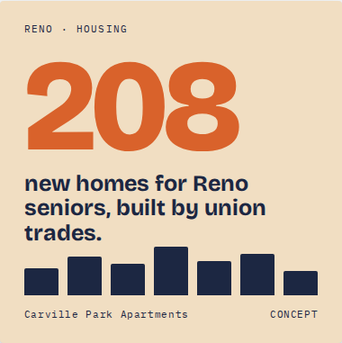

# Digital Portfolio

Ben Adams: digital graphics for campaigns and political organizing.

## Graphics

<table>
<tr>
<td width="33%" valign="top">

 <b>Flip MD-01: Digital Ground Game</b> 
Event poster for Maryland Young Democrats: a canvass and after-party targeting Maryland's 1st District.
</td>
<td width="33%" valign="top">

 <b>Small Business Grant Outreach</b> 
Instagram post (1080×1350) for an application to Congresswoman Emily Randall's office, promoting help with SBA grants and loans.
</td>
<td width="33%" valign="top">

 <b>Reno Housing: Concept</b> 
Concept graphic for the Carville Park Apartments: 208 new homes for Reno seniors, built by union trades.
</td>
</tr>
</table>
