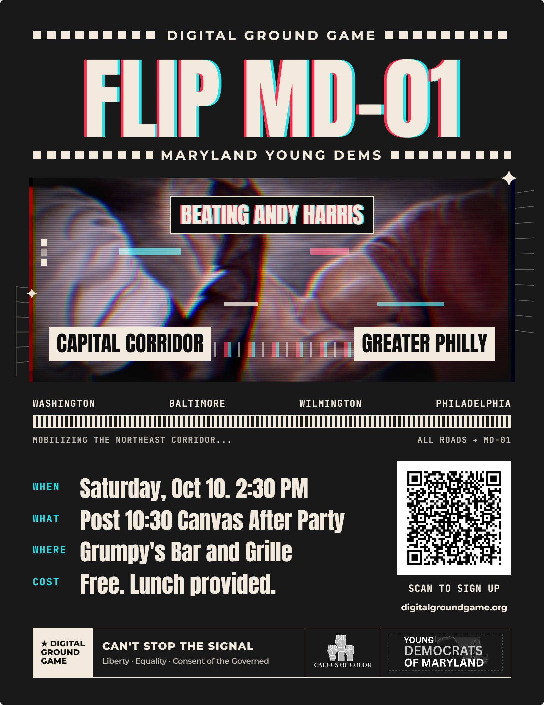
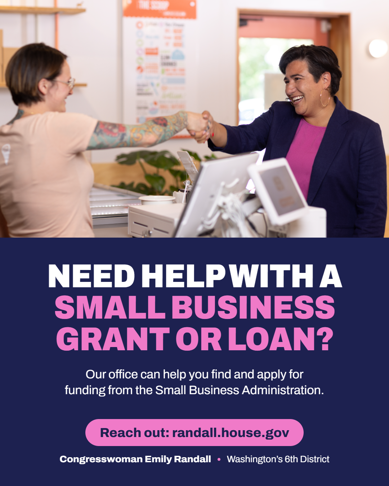

# Digital Portfolio

Ben Adams: digital graphics for campaigns and political organizing.

I make graphics that get people to do something: show up to a canvass, apply for help their representative's office can give them, or get to the polls before they close. I like bold type, one clear message per graphic, and a call to action you can read in the second it takes to scroll past. Most of my work is built for Instagram and event promotion, sized and laid out for the platform it's posted on.

## Graphics

<table>
<tr>
<td width="50%" valign="top">

 <b>Flip MD-01: Digital Ground Game</b> 
Event poster for Maryland Young Democrats: a canvass and after-party targeting Maryland's 1st District.
</td>
<td width="50%" valign="top">

 <b>Small Business Grant Outreach</b> 
Instagram post (1080×1350) for an application to Congresswoman Emily Randall's office, promoting help with SBA grants and loans.
</td>
<td width="33%" valign="top">
</td>
</tr>
</table>
